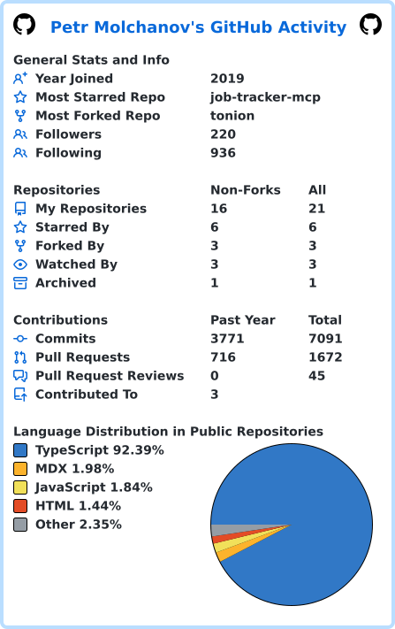

<!-- Profile README for kurkul608 -->

<h1 align="center">Hi, I'm <strong>Petr Molchanov</strong> 👋</h1>

  <strong>Senior AI Engineer</strong> • LLM agents, RAG, MCP, evals • TypeScript & Python • Full-stack (React, Node.js) • Buenos Aires, Argentina

  ✍️ I write about building agents at <a href="https://molchanov.blog"><strong>molchanov.blog</strong></a>

---

### 👨‍💻 What I do

* 🤖 **Production coding agent (ROGII):** I built and operate an autonomous multi-agent coding system in production. It picks up Jira tasks, writes the fix, passes independent AI review and opens merge requests. I also built its human-in-the-loop guardrails, its Retrieval-Augmented Generation (RAG) layer over project docs and code history, and the evals that measure its quality. Stack: Claude Agent SDK, TypeScript, Docker.
* 🛠 **Agent skills for the team:** I wrote reusable agent skills that moved QA from manual to agent-driven Playwright e2e testing and sped up onboarding of new engineers.
* 📊 **LLM pipelines with evals (independent work):** for a B2B parts marketplace I built a tiered pipeline: rules first, then local classifiers, then a hosted LLM with OpenRouter fallback. It runs 20+ AI features with Zod-validated structured outputs and Langfuse tracing, an eval suite over 1,300+ labeled examples, and a read-only Model Context Protocol (MCP) server.
* 🔎 **Multi-agent research:** I built a Claude Code multi-agent research system for company research. An orchestrator plans the work and checks the results, and 8 subagents research in parallel. One run maps a company's subsidiaries and contractors, then tests hypotheses about it against public sources. An open-source version is in progress.
* 🧩 **Before AI, full-stack and UI engineering:** I built the React/TypeScript UI for an oil & gas geosteering platform (Canvas 2D well cross-sections, Leaflet to Mapbox migration, ArcGIS integration). At ROKO Labs I cut bundle size 15% and page load time 20%, and built a virtualized data grid for 10,000+ rows at 60fps. Backend: Node.js, NestJS, Fastify, Python/FastAPI, PostgreSQL.

---

### 📌 Projects

* **[Body Double](https://github.com/kurkul608/body-double)** — a self-hosted AI tutor built for ADHD brains. It teaches the open course [AI Engineering from Scratch](https://github.com/rohitg00/ai-engineering-from-scratch) one lesson at a time. Early beta.
* **[qwen-image-apple-silicon-bench](https://github.com/kurkul608/qwen-image-apple-silicon-bench)** — Qwen-Image-2.1 benchmark on Apple Silicon (M1 Pro, 32 GB): GGUF quantizations Q4/Q8/F16 via stable-diffusion.cpp; speed, memory and image quality.
* **[molchanov.blog](https://github.com/kurkul608/molchanov-blog)** — my blog. Astro + React + Feature-Sliced Design on Cloudflare Pages, with a free "Markdown for Agents" layer for AI crawlers and IndexNow on every deploy.
* **Multi-agent research agent** — orchestrator + 8 parallel subagents, hypothesis checks, SQLite knowledge base. Open-source version coming.

More on [molchanov.blog/projects](https://molchanov.blog/projects/).

---

### 🛠 Stack

        

        

---

### 🔗 Let's connect

Building agents too? I like comparing notes.

  
  
  
  

---

  

